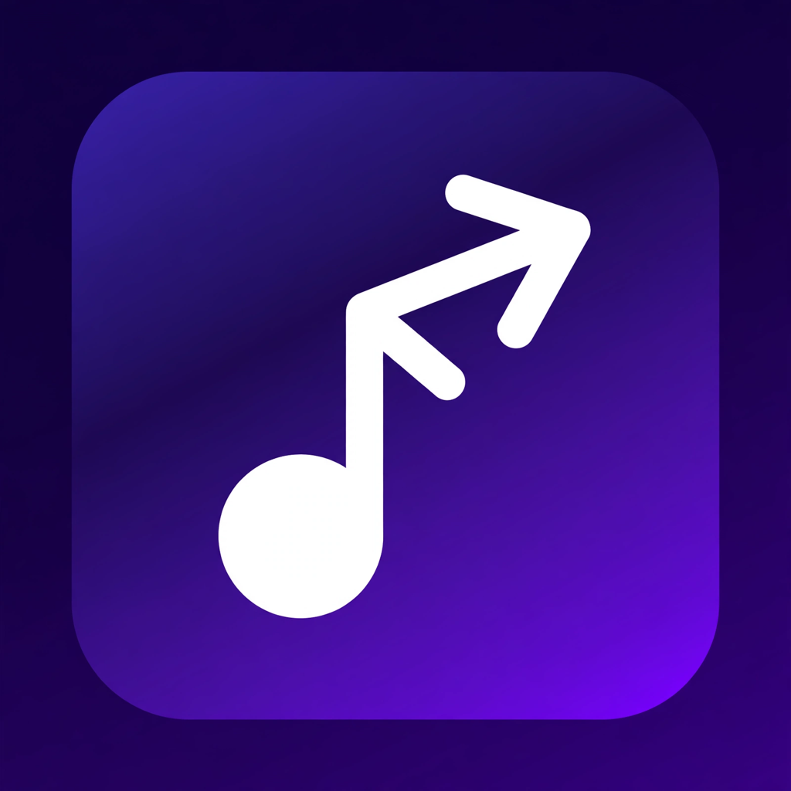
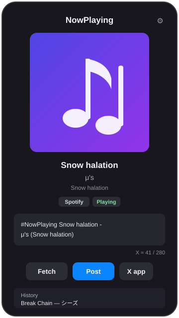
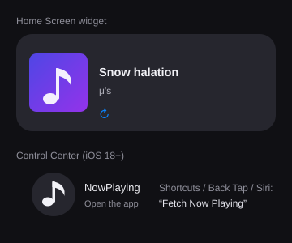

# NowPlaying

<p align="center">
  
</p>

Share the track you are listening to as a `#NowPlaying` post, from Spotify or Apple Music.

SpotifyやApple Musicで再生中の曲を `#NowPlaying` 投稿にするためのアプリ。

## Screenshots

<p align="center">
  
  
</p>

*UI illustrations, drawn to match the actual layout.*

## Features

- Fetches the currently playing track from **Spotify** (Web API) or **Apple Music** (MediaPlayer)
- **Auto** source: prefers what is actually playing on this device
- Album artwork and track URL resolved through the iTunes Search API, preferring an exact track + album + artist match instead of blindly taking the first result
- Long-press the artwork to pick a different candidate (iTunes, MusicBrainz, YouTube Music, or the source service's own artwork), or to report a wrong pick as a prefilled GitHub issue; the automatic priority order between the sources is configurable in Settings
- Custom post format with `{track}` / `{artist}` / `{album}` / `{url}` placeholders, plus switchable format presets
- Editable post text with an approximate X character count, source / playing-state badges, and a fetch history
- Direct posting to X (app or API), Bluesky, Mastodon, and Misskey — see below
- Optional Last.fm: fetch source (username + API key), Now Playing on fetch, and scrobble when you post
- Home Screen widget (medium / small) with a refresh button, a Control Center control (iOS 18+), and App Shortcuts (Shortcuts / Back Tap / Siri)
- English / Japanese UI

## Requirements

- iOS 17+
- For Spotify: your own Spotify Developer app (free) and a refresh token — see below
- The app is distributed as an unsigned `.ipa`; install it with SideStore, AltStore, or a similar tool

## Install

1. Download `NowPlaying.ipa` from [Releases](../../releases).
2. Install it with SideStore / AltStore.
3. Open the app, go to Settings, and fill in your Spotify credentials if you use Spotify.

## Spotify setup

1. Create an app at <https://developer.spotify.com/dashboard>.
2. In the app settings, add the redirect URI: `http://127.0.0.1:8888/callback`
3. Add your Spotify account under **Users and Access** (development mode).
4. Open the following URL in a browser (replace `YOUR_CLIENT_ID`), sign in, and agree:

   ```
   https://accounts.spotify.com/authorize?client_id=YOUR_CLIENT_ID&response_type=code&redirect_uri=http%3A%2F%2F127.0.0.1%3A8888%2Fcallback&scope=user-read-currently-playing%20user-read-playback-state
   ```

5. The browser redirects to `http://127.0.0.1:8888/callback?code=...` (the page itself will not load — that is expected). Copy the `code` value.
6. Exchange the code for a refresh token:

   ```sh
   curl -X POST https://accounts.spotify.com/api/token \
     -d grant_type=authorization_code \
     -d code=THE_CODE \
     -d redirect_uri=http://127.0.0.1:8888/callback \
     -d client_id=YOUR_CLIENT_ID \
     -d client_secret=YOUR_CLIENT_SECRET
   ```

7. Paste the returned `refresh_token`, the Client ID, and the Client Secret into the app's Settings.

## Settings

| Key | Values | Default |
| --- | --- | --- |
| Source | Auto (this device first) / Spotify / Apple Music | Auto |
| URL | Off / Space-separated / New line | Off |
| Artwork | On / Off, Standard / High (1200px) | On, Standard |
| Format | Template with `{track}` `{artist}` `{album}` `{url}` | `#NowPlaying {track} - {artist} ({album})` |

If the format contains `{url}`, the URL setting is ignored.

## Posting destinations

Besides the iOS share sheet, the app can post directly (credentials are entered in Settings; all optional):

- **X (app)**: opens the X app's compose screen with the text (no image attachment).
- **X (API)**: posts text and artwork directly through the X API. Create an app at <https://developer.x.com>, set its permissions to **Read and Write**, and generate an access token for your account *after* that change. Fill in API Key / API Secret / Access Token / Access Token Secret.
- **Bluesky**: handle + an app password (Bluesky Settings → Privacy and Security → App Passwords). Custom PDS hosts are supported via the Server field.
- **Mastodon**: instance host + an access token (Preferences → Development → New application, scopes `write:statuses` and `write:media`).
- **Misskey**: instance host + an API token (Settings → API).

## Build from source

The Xcode project is generated with [XcodeGen](https://github.com/yonaskolb/XcodeGen):

```sh
brew install xcodegen
xcodegen generate
xcodebuild build -scheme NowPlaying -sdk iphoneos -configuration Release CODE_SIGNING_ALLOWED=NO
```

Pushing a tag like `v1.2` builds the app on GitHub Actions and attaches `NowPlaying.ipa` to the GitHub Release.

## References

The feature set was inspired by geckour's NowPlaying4Droid (Android). That project is GPLv3; no code from it is used here — this app is an independent implementation.

## License

MIT
